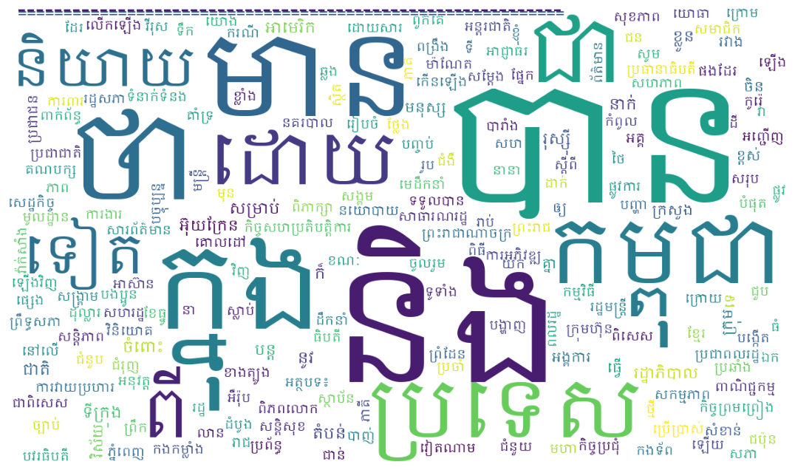
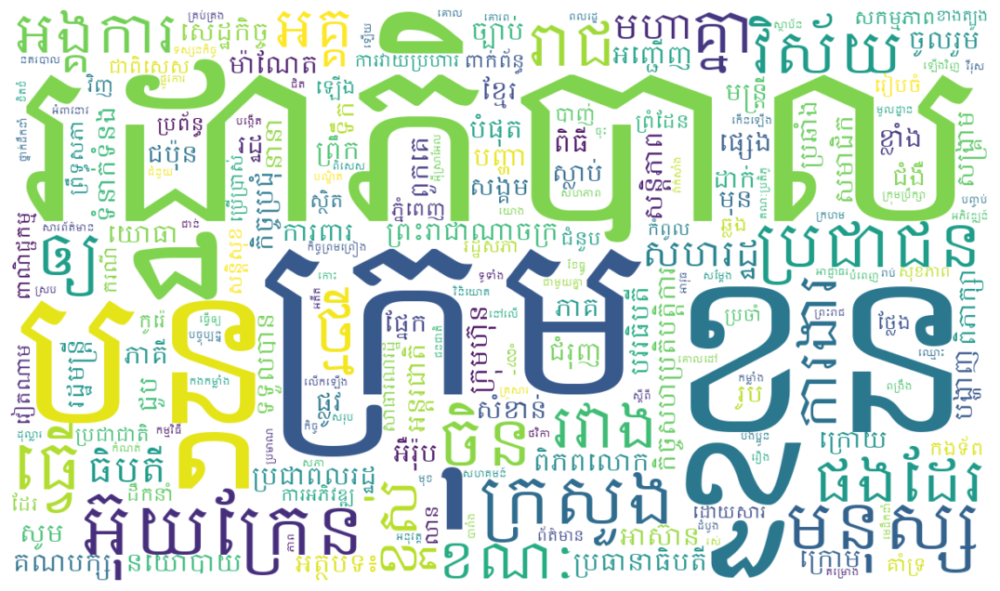

# Khmer Semantic Similarity Detection using RNN-based Representation Learning

Detecting whether two Khmer words are semantically similar, using **character-level** neural encoders (RNN, LSTM, GRU) in a Siamese setup, with a two-stage idea: unsupervised pre-training of word representations, then supervised similarity classification.

## Introduction

Khmer is a low-resource language with features that make word-level NLP difficult: stacked consonants (coeng), dependent vowels and diacritics, and no spaces between words. This project avoids word segmentation for the model input by encoding each word as a sequence of **Khmer Unicode characters** and learning a vector for the whole word, so that similar words end up close together.

## Problem statement

Given a pair of Khmer words, predict whether they are similar (label 1) or not (label 0). The theoretical formulation (input space, encoder mapping, objectives) is written up in [docs/Section2_Update.md](docs/Section2_Update.md).

## Objectives

- Represent variable-length Khmer words as fixed-size vectors from character sequences.
- Compare recurrent encoders (SimpleRNN, LSTM, GRU and variants) for pairwise similarity.
- Explore pre-training (character autoencoder), fine-tuning and contrastive learning.

## Main features

| Feature | Notebook |
|---|---|
| Keras Siamese models: Simple RNN, Basic LSTM, Basic GRU, Advanced LSTM, hybrid LSTM/GRU, attention LSTM/GRU, contrastive LSTM, with a comparison and example word pairs | `notebooks/similarity (1).ipynb` |
| PyTorch pipeline: Khmer text corpus processing, character autoencoder pre-training, fine-tuning, contrastive learning, an "improved" version with augmentation of similar pairs, and word-cloud visualisations | `notebooks/Pre-trained.ipynb` |

## Technologies

| Area | Tools (from the notebooks' imports) |
|---|---|
| Deep learning | TensorFlow / Keras (similarity notebook), PyTorch (pre-training notebook) |
| Khmer NLP | `khmernltk` (word tokenisation) |
| Data and evaluation | pandas, NumPy, scikit-learn |
| Visualisation | Matplotlib, wordcloud, tabulate, tqdm |

## Dataset

| File | Content |
|---|---|
| `data/khmer_semantic_similarity_dataset_chars.csv` | 11,998 labelled word pairs (`word1`, `word2`, `similarity`, `chars1`, `chars2`): 3,087 similar and 8,911 dissimilar (about 26% positive) |
| `data/khmer_unique_words.csv` | Unique words with character tokens (about 27 thousand rows) |
| `data/khmer_words_with_char_tokens.csv` | Words with character tokens (about 28 thousand rows) |

The character vocabulary built in the pre-training notebook has 87 symbols. The source and licence of the word pairs are **not documented** in this repository. The pre-training notebook also uses a Khmer news text file and a stop-word list that are **not included** (`news_text_file_v3.txt`, `Khmer-Stop-Word-1000.csv`).

## Architecture

```
word 1 chars ─┐                              ┌─ combine the two word vectors ─ dense layers ─ sigmoid ─> similar?
              ├─ shared embedding ─ shared RNN encoder (LSTM / GRU) ─┤
word 2 chars ─┘
```

Both words pass through the same embedding and encoder (a Siamese network); the two word vectors are combined and classified. The contrastive variants instead learn embeddings whose distance is small for similar pairs.

## Existing results

Values are copied from the notebook outputs. **Read the caveats below the tables.**

**Keras Siamese models** (`similarity (1).ipynb`; 80/20 split, `random_state=42`, 2,400 held-out pairs: 1,737 dissimilar, 663 similar). The notebook labels these as "Test" metrics.

| Model | Accuracy | Precision | Recall | F1 | AUC |
|---|---|---|---|---|---|
| First LSTM baseline | 0.7517 | 0.59 | 0.33 | 0.42 | not reported |
| Simple RNN | 0.7237 | 0.0000 | 0.0000 | 0.0000 | 0.5310 |
| Basic LSTM | 0.8512 | 0.8012 | 0.6139 | 0.6951 | 0.8902 |
| Basic GRU | 0.8637 | 0.7989 | 0.6772 | 0.7331 | 0.8915 |
| Advanced LSTM | 0.8525 | 0.7262 | 0.7481 | 0.7370 | 0.8930 |

(Precision, recall and F1 are for the *similar* class. The first baseline row is from the notebook's classification report.) The hybrid, attention and contrastive models are also trained in the notebook, but it logs only a validation loss and an unlabeled `compile_metrics` value for them, so no comparable metrics are listed.

**PyTorch pipeline** (`Pre-trained.ipynb`; best validation results printed in the notebook's summary cell):

| Stage | Best validation accuracy | Best validation F1 |
|---|---|---|
| Fine-tuning | 0.8578 | not reported |
| Contrastive learning | 0.8583 | not reported |
| "Improved" (with augmentation of similar pairs: 15,085 pairs, 40.9% similar) | 0.9545 | 0.9458 |



*Figure: word cloud of word frequencies after tokenisation of the Khmer text corpus (notebook output).*



*Figure: word cloud of weighted word scores with the 20 highest-scoring words removed (notebook output).*

### Caveats about these numbers

- The Simple RNN's accuracy (0.7237) equals the share of dissimilar pairs in the test set (1,737 / 2,400), and its precision and recall are zero: it predicted only the majority class.
- For every Keras model the "Test" values equal the best **validation** values exactly (for example Basic LSTM: test AUC 0.8902, best validation AUC 0.8902), which suggests the evaluation reused the validation data. They should be read as validation results, not an independent test.
- The PyTorch and Keras results use different frameworks, splits and (for the "improved" run) data augmentation, so they are **not directly comparable**. The notebook does not document whether augmented copies of the same pair can fall on both sides of its split.
- The class imbalance (about 74% dissimilar) makes accuracy alone misleading; the F1 and recall for the similar class are lower.

## Folder structure

```
Khmer-semantic-similary-detection-using-RNN-based-Rerpesenationlearning/
├── README.md
├── notebooks/
│   ├── Pre-trained.ipynb         # PyTorch pre-training, fine-tuning, contrastive learning
│   └── similarity (1).ipynb      # Keras Siamese models and comparison
├── data/                         # the three CSV datasets
├── docs/
│   ├── Section2_Update.md        # theoretical framework and mathematics
│   └── drafts/temp_header.src    # a draft "Introduction" text (UTF-16), kept as found
└── assets/images/                # figures used in this README
```

The files were originally in the repository root; they were moved (locations only, contents unchanged) into folders. The notebooks load their data from absolute paths (a Kaggle input path in the Keras notebook, `D:\...` paths in the PyTorch notebook), so they do not depend on this layout.

## Installation

No requirements file exists and library versions were not recorded. The original README states Python 3.8+ and TensorFlow 2.x. From the imports, the notebooks need:

```bash
pip install tensorflow torch pandas numpy scikit-learn matplotlib wordcloud tqdm tabulate khmernltk
```

## Usage

1. Open a notebook in Jupyter or Kaggle.
2. Change the data path in the first data-loading cell to the file in `data/` (the notebooks contain the original Kaggle and `D:\...` paths).
3. Run the cells in order. `Pre-trained.ipynb` also needs a Khmer text corpus and a Khmer font (the word clouds use `KhmerOS.ttf`).

## Limitations

- No trained models, `.pkl` files or saved weights are included (the original README mentions `*.pkl` files that are not in the repository).
- Data paths in the notebooks are not portable; one cell in `Pre-trained.ipynb` imports a placeholder module (`your_stage2_code`).
- No independent test set is documented; see the caveats above.
- The origin and licence of the word-pair labels are not documented.
- No tests.

## References and acknowledgements

- Khmer word tokenisation: `khmernltk`.
- Siamese networks and contrastive learning are standard techniques; no specific paper is cited in the original project.
